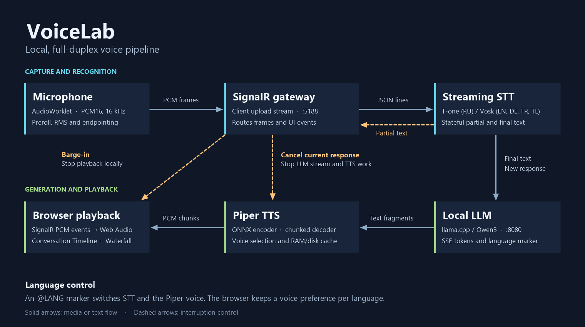

# VoiceLab architecture

VoiceLab is a local, full-duplex voice conversation app for Windows. It runs on ASP.NET Core 10 with a static browser UI and three streaming model stages. All services bind to loopback.

| At runtime | Implementation | Transport |
| --- | --- | --- |
| Browser capture and playback | `wwwroot/capture.js`, `wwwroot/app.js` | AudioWorklet captures PCM16 mono at 16 kHz, SignalR over WebSocket, playback through Web Audio |
| Conversation gateway | `Program.cs`, `VoiceHub` on port 5188 | SignalR input stream `Listen`, operations `Run` and `Interrupt`, server events `mic` and `event` |
| Streaming STT | `OnlineStt.cs` launches `online_stt.py` per active microphone stream | JSON lines over redirected stdin/stdout, stateful decode for each utterance |
| LLM | llama.cpp / Qwen3-1.7B Q4_K_M, port 8080 | Local chat completions with SSE, CUDA and thinking disabled |
| TTS | `PcmTts.cs` calls `piper_pcm.py`, port 5193 | HTTP POST with text and voice, raw 16-bit little-endian PCM response and `X-Sample-Rate` |
| Optional prompts | Langfuse, port 3000 | Gateway proxy for named text prompts and labels |

## Utterances and interruption

1. The microphone stays open until the user explicitly stops it. The browser uses RMS to open an utterance and sends a short preroll followed by approximately 40 ms frames. After the configured silence, normally 160 ms, it sends the finalization frame.
2. The worker retains acoustic state between frames. Partial hypotheses update the user message. Two successive hypotheses that agree on the first two words trigger client playback cancellation and server interruption. A final hypothesis can also interrupt and start a new response, including short commands.
3. `Run` starts a response with per-connection/per-response cancellation. llama.cpp streams visible text deltas. A bounded channel sends text fragments to the Piper consumer while generation continues. The browser schedules audio chunks as they arrive. The TTS cache uses RAM for 2 minutes and disk for 5 hours. Explicit re-synthesis bypasses both.
4. The browser owns conversation history and replay audio. Reset cancels the current response, clears history and measurements, and restores the initial language. An open microphone stays open.

## Language routing

`Languages.cs` maps `ru`, `en`, `de`, `fr`, and `tl` to locales and Piper voices. STT uses T-one for Russian and Vosk for the other four languages. The gateway appends the language protocol to the system prompt, recognizes a leading `@LANG:<code>` (including `@LANG:home`), and sends a language event before the localized confirmation. No control text is played. The browser prepares the corresponding recognizer for the next utterance. Input and reply languages are tracked during audio replay.

## Measurements

Conversation Timeline shows utterances on a shared browser time axis. Waterfall shows STT partial and final, VAD, the first visible LLM token, first PCM for each TTS fragment, and scheduled playback. Server intervals are measured with a monotonic clock, and browser capture and playback use browser clocks. Verify latency with warmed models and a physical loopback before making an audio-to-audio SLA claim.
